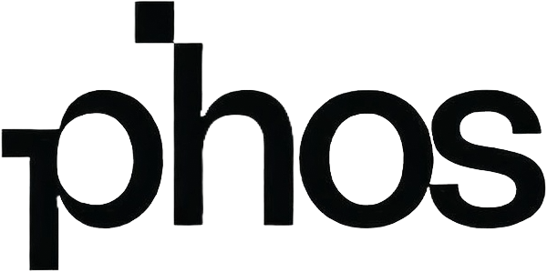

<p align="center">
  
</p>

# PHOS

**Behavioural security for industrial systems. Every alert names the explanations it can't rule
out, and the one fact that would settle it.**

Signature-based security catalogues attacks that are already known. An attacker who holds valid
credentials and sends well-formed commands to a plant breaks no signature at all. What they do
change is how the plant behaves.

PHOS learns what normal operation looks like and reports when the plant stops looking like itself.
It does not stop at a score. Each alert carries:

1. **What happened**, in plain English, with the measurements behind it.
2. **The explanations that are still possible.** Attack, maintenance, a fault, or not enough
   evidence to say. The ones it cannot rule out stay on screen.
3. **The one fact that would settle it**, for example whether a work order covered that unit at
   that time.

When the data cannot support a conclusion, PHOS says so instead of guessing. That rule is enforced
by the test suite, not left to good intentions.

## Status

**Research pre-release.** PHOS is not deployable and has never run on a live plant. It is
evaluated on published datasets and on simulated plants built to break it.

We publish what PHOS cannot do alongside what it can. Measurements and their limits:
[Atlas report](docs/atlas-report.md) · [What PHOS refuses to claim, and why](docs/refusal-register.md) ·
[How the simulated plants avoid fooling us](docs/synthetic-harness-method.md) ·
[Design decisions](docs/adr/)

## The engines

- **Atlas** (industrial control systems) models a plant as one connected physical machine rather
  than a set of independent sensors.
- **Sentiel** (enterprise networks) models people rather than machines. Research only.

Both write into one shared model, so every conclusion traces back to the observation that produced
it.

## Run it

```bash
uv sync
uv run pytest -q          # the full suite, no datasets needed
```

Public datasets are downloaded separately and never committed. See [data/README.md](data/README.md).

## How it is built

PHOS is built by one independent researcher working with AI coding agents. Every published number
can be reproduced from this repository and the public datasets it names, and the rules that stop a
result being overstated are written as tests that fail if anyone, human or agent, removes them.

## Licence

Source-available under the [PolyForm Noncommercial License 1.0.0](LICENSE): free for research,
study, teaching and personal use. Commercial use, including use inside a product or at a client
site, requires a separate licence from the author.
