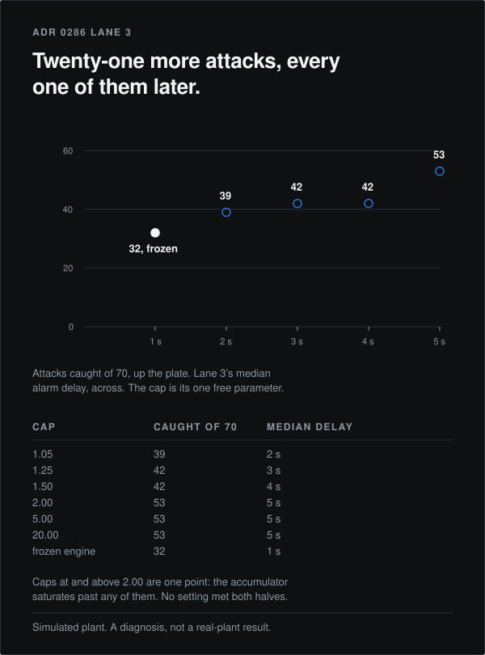
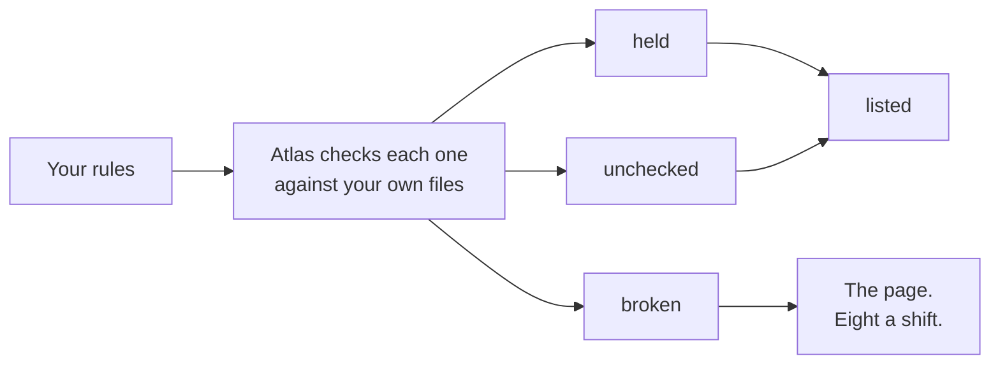

[](https://github.com/elijahagumba/phos/actions/workflows/research-core.yml)

# PHOS

### Your plant's rules are your plant's.

Atlas never connects to your control network. It reads the files your plant already exports, checks them against the rules your own engineers wrote down, and hands the list back marked.

It keeps no model of your site. It has no opinion your own record cannot support.

---

## What it does

Your plant runs by rules. Flow follows the pump. That valve answers to that comparison. Nobody writes to a controller without a work order.

Atlas checks whether each rule still holds, and shows you the ones that stopped.

**At most eight a shift.** Not eight after filtering. Eight is the ceiling, and a ninth is refused rather than queued.

**No score.** A line is the rule's name, then the fact that broke it. Nothing to calibrate. Nothing to argue with.

**It says when it does not know.** A rule it cannot check is shown as unchecked, never as passed. An empty page means the checks ran and the rules held. It never means the plant is safe.

Atlas is a witness, not a judge. A line means someone should go and look.


## What it will not do

- Connect to a control network.
- Learn what your site is from your site's data.
- Put a number, a score or a rank on a line.
- Decide from a byte on the wire that someone downloaded a program.
- Guess whether a change was authorised. That lives in your work orders, and Atlas does not have them.
- Call a contractor an intruder, or an intruder a contractor.
- Tell you that an empty page means you are safe.

Each of those is a line of code, not an intention.

---

## The part most projects leave out

Three detectors were built, measured, and then refused. They are still in this repository, with the records that killed them.

**One caught more attacks and was refused anyway.** 53 of 70, against the shipping engine's 32, losing nothing. It arrived a few seconds later. The bar forbade a later alarm. [ADR 0286](docs/adr/0286-an-appended-column-cannot-win-a-slot-without-taking-the-alert.md)



**One modelled the plant properly and made us blinder.** Quieter on false alarms, and it caught a quarter fewer attacks. Some of what the shipping engine detects turns out to be a side effect of its own bad fit. We would rather you read that here than find it yourself. [ADR 0288](docs/adr/0288-the-linear-predictors-misfit-is-load-bearing.md)

**One ranked the queue, and the ranking pointed away.** Sorted by how loud each alert was, every real one landed in the bottom half of a 424-line queue. So Atlas does not rank. [ADR 0068](docs/adr/0068-the-atlas-operator-queue-cannot-be-ranked.md)

A project that publishes what it refused is making a different kind of promise from one that publishes only what worked.

[Every refusal →](docs/refusal-register.md)

---

## How it gets proven

A detector is only as good as what it was tested on. Six plant structures is not a population, and one that has memorised six looks excellent while having nothing to say about the seventh.

So Atlas is examined against plants that are drawn, not reused. A family fixes a process structure and leaves its numbers open. A seed draws one plant from it.

Five families exist. **A sixth is sealed** — kept out of the registry, out of the documents, out of the published bounds, so that nothing in this repository can point a detector-builder at it.

A plant that could not physically exist is refused rather than clipped, and a third of the first draws were refused. The same seed writes byte-identical files on another machine, and on another kind of machine.

**Nothing has been scored on a drawn plant yet.** The generator is built. The referee is not. There is no recall and no verdict for Atlas here, and none may be quoted from this page.

[How a plant is drawn →](docs/sim/README.md) · [What it still cannot do →](docs/sim/coverage.md)

---

## The rules it checks today

| | A break is |
| --- | --- |
| **Joint move** | Two tags moved together inside the ordinary band |
| **Subfloor walk** | One tag stepped across that band and stayed |
| **Band handoff** | The same quiet value reappears on a second tag, and no booking names both |
| **Program transfer** | A download, upload or online edit that nothing booked covers |
| **Allowed writer** | A write from a station the plant never named |
| **Controller valve** | A valve that is not what the plant's own comparison writes |

A rule your register names and Atlas cannot check is listed as unchecked. It takes no slot and makes no claim.

The same contract stated formally, and pinned to the code that enforces it: [what the page refuses](docs/whitepaper/eight-alert-non-admission.md).



## Where it stands

Atlas has **never run on a live plant.** Every figure comes from public testbed data or from simulation, and nobody outside this project has reproduced any of it.

On three editions of HAI, a real industrial testbed, the older residual engine caught 131 of 160 attacks inside the eight-alert budget. Its opponent was grouped min-max normalisation — an elementary baseline, named plainly here because a reader deserves to know what a comparison is worth. A multivariate VAR(1) baseline was also tried, and was louder. Reconstruction baselines and HAI's own published results are the next measurement, and they are not done.

Checking declared rules against process data is a known family: invariant and specification-based detection. What is new here is not the check. It is the custody.

Version 1 meets 8 of its 12 criteria. The four it misses: the queue cannot be ranked, no outsider has reproduced it, the second engine finds one insider of two, and no plant has run the onboarding trial.

[Every number, with the record that earned it →](docs/)

---

## Run it

```bash
uv sync
uv run phos demo
```

Fifteen seconds. A simulated water plant, 120 hours, and the demo then tells you what it missed.

Have a historian export?

```bash
uv run phos onboard --historian your-export.csv
```

It proposes a role for every tag and shows the token or the statistic each proposal came from. Where it has nothing to go on, it leaves the cell blank.

**Nothing leaves your machine.** One local file, no network calls, no subprocesses, and it writes only the brief you asked for. The output is a draft for an engineer to correct, and the corrected list is the thing worth sending back — never the data.

6,195 tests pass and 162 skip, each naming why, and no datasets are required: `uv run pytest -q` runs on a fresh clone in about five minutes.

## Talk to us

**If you run or secure an industrial site** and can export historian files and write down which rules matter: that is the conversation PHOS most wants. The page will not show you a score, and Atlas will not touch your control network.

**If you are a researcher**, the measurements reproduce and the corpora are named. Disagreements about method belong in [Discussions](https://github.com/elijahagumba/phos/discussions).

[elijahagumba.research@proton.me](mailto:elijahagumba.research@proton.me)

---

Research pre-release. Not deployable. Never run on a live plant.

Built by one researcher with AI coding agents. Every number on this page reproduces from this repository and the public data it names.

Source-available under the [PolyForm Noncommercial License 1.0.0](LICENSE).
