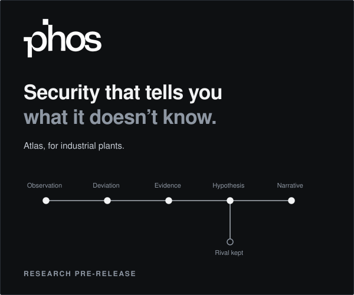

<p align="center">
  
</p>

<br>

<p align="center">
  An attacker with valid credentials breaks no signature.<br>
  What they change is how the plant behaves.
</p>

<p align="center">
  PHOS learns how a plant behaves when nothing is wrong. When that changes,<br>
  it writes down every explanation it can't rule out, and the one fact that would settle it.
</p>

<br>

<p align="center">
  
</p>

<br>

<p align="center">
  
</p>

<br>

<p align="center">
  
</p>

<br>

<p align="center">
  <a href="docs/bets/001-the-second-insider.md"></a>
</p>

<br>

<p align="center">
  <a href="docs/"><b>Read the record</b></a>
  &nbsp;&nbsp;·&nbsp;&nbsp;
  everything PHOS has measured, including what didn't work
</p>

<br>

### Run it

```bash
uv sync
uv run phos demo
```

About fifteen seconds. A simulated water plant runs for 120 hours, something writes to its
controller, and Atlas writes its brief. Then the demo shows what actually happened, and says so
plainly when Atlas missed it or raised a false alarm. Try `--scenario operator` and
`--scenario attacker` too.

```bash
uv run pytest -q
```

The test suite needs no datasets. Public corpora are downloaded separately and never committed; see
[data/README.md](data/README.md).

<br>

<p align="center">
  <sub>Research pre-release. Not deployable, and never run on a live plant.</sub><br>
  <sub>Atlas models industrial plants. Sentiel, its enterprise sibling, is research only.</sub><br>
  <sub>Built by one researcher with AI coding agents. Every published number reproduces from this repository and the public datasets it names.</sub><br>
  <sub>Source-available under the <a href="LICENSE">PolyForm Noncommercial License 1.0.0</a>. Commercial use requires a licence.</sub>
</p>
