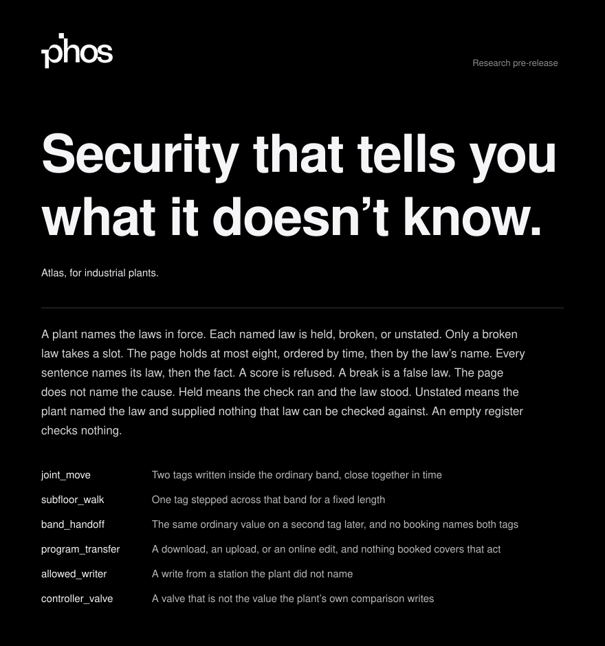
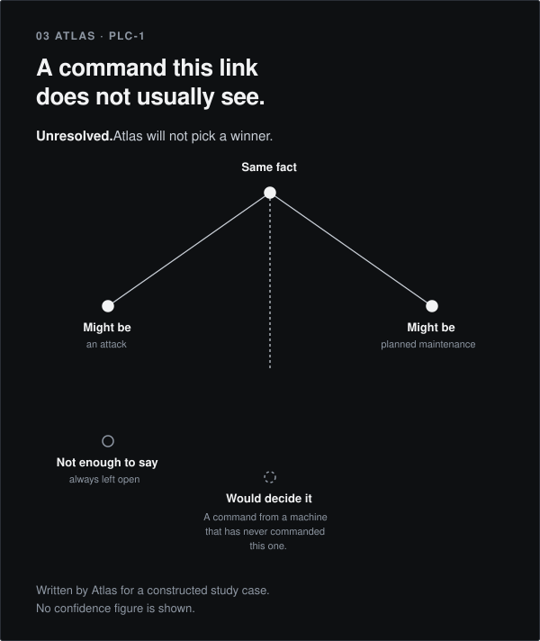
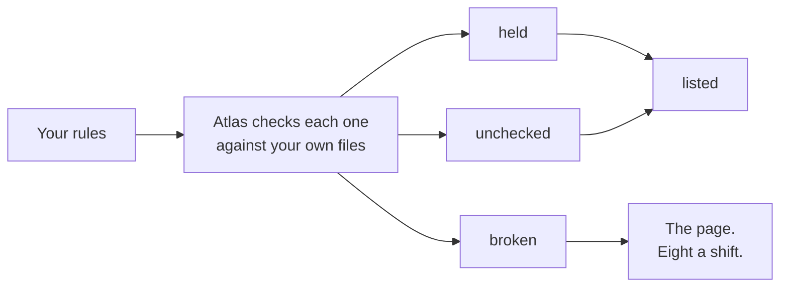
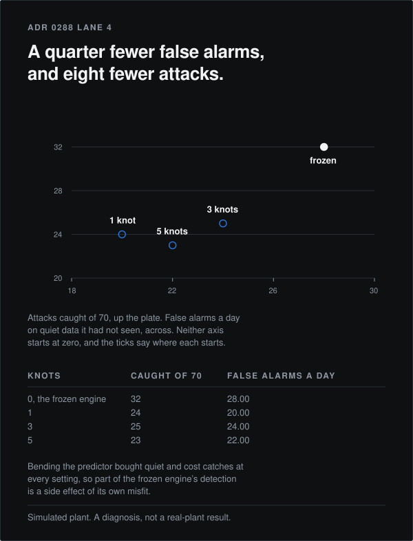
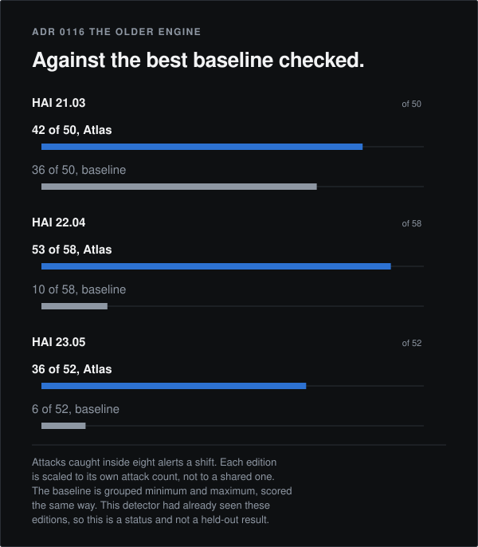
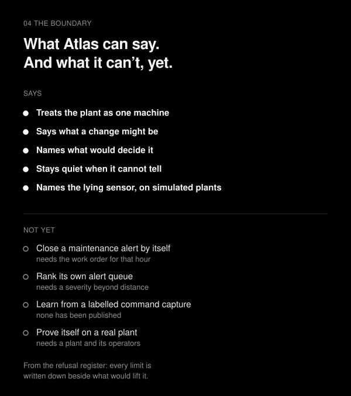
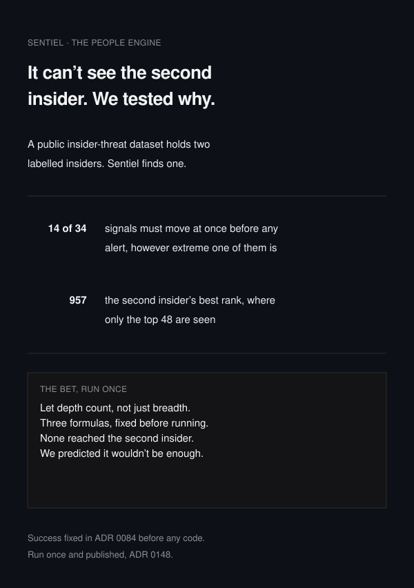

[](https://github.com/elijahagumba/phos/actions/workflows/research-core.yml)

# PHOS

### Your plant's rules are your plant's.

Atlas never connects to your control network. It reads the files your plant already exports, checks them against the rules your own engineers wrote down, and hands the list back marked.

It keeps no model of your site. It has no opinion your own record cannot support.

**PHOS is an independent research project, built by one researcher with AI coding agents.** There is no company, no product and no customer, yet. What there is, is a measurement record: every figure on this page reproduces from this repository and the public datasets it names, including the measurements that failed.

---

## What it does

Your plant runs by rules. Flow follows the pump. That valve answers to that comparison. Nobody writes to a controller without a work order.

Atlas checks whether each rule still holds, and shows you the ones that stopped.

**At most eight a shift.** Not eight after filtering. Eight is the ceiling, and a ninth is refused rather than queued.

**No score.** A line is the rule's name, then the fact that broke it. Nothing to calibrate. Nothing to argue with.

**It says when it does not know.** A rule it cannot check is shown as unchecked, never as passed. An empty page means the checks ran and the rules held. It never means the plant is safe.

Atlas is a witness, not a judge. A line means someone should go and look.



## What it will not do

- Connect to a control network.
- Learn what your site is from your site's data.
- Put a number, a score or a rank on a line.
- Decide from a byte on the wire that someone downloaded a program.
- Invent a work order. If you supply one that names the tag and the time, a valve command inside that window is silence. If you supply none, the command is a break. Atlas does not guess the paperwork.
- Call a contractor an intruder, or an intruder a contractor.
- Tell you that an empty page means you are safe.

Each of those is a line of code, not an intention.

---

## The contract, exactly

Most security products describe their behaviour in prose and implement something else. These four lines are not a description of what Atlas is meant to do. Each one is what [`src/phos/atlas/declared_law.py`](src/phos/atlas/declared_law.py) already enforces, and a test fails if the page and the code drift apart in either direction.

$$\mathcal{R} \;=\; H \;\sqcup\; B \;\sqcup\; U$$

Every law in the register your plant signed ends in exactly one of three standings: held, broken, or unstated. A law that turns up in two of them is refused, and no report is built.

$$\mathrm{page} \;=\; (\mathrm{sort}_{(t,\,n)} B)_{1 \ldots \min(|B|,\,8)}$$

The page is the broken laws, ordered by the time of the broken fact and then by the law's name, cut at eight. Held and unstated laws are listed and take no slot, and a later break is never promoted for being louder, because a break carries nothing to be louder with.

$$W \;=\; \{\textsf{confidence},\; \textsf{probability},\; \textsf{weight},\; \textsf{magnitude},\; \textsf{score}\}$$

Five words a sentence may not contain. The refusal is the word, not a number: a decimal your plant already uses is allowed, and a law whose own name carries one of these words is your word and is read as a name.

$$\text{placed}(b) \iff \mathrm{type}(b) = \texttt{LawBreak} \;\wedge\; s_b = n_b \,\Vert\, \text{". "} \,\Vert\, f_b \;\wedge\; \forall w \in W: w \not\subseteq \mathrm{fold}(f_b)$$

A line is placed only if it is exactly a break, its sentence opens with its own law's name, and the fact after that name contains none of the five words in any case. The type check is exact rather than by inheritance, because a subclass could carry a magnitude. A sentence that fails any of the three raises, and nothing else in that call is placed either.

The longer argument for why a page that refuses is worth more than a page that ranks: [what the page refuses](docs/whitepaper/eight-alert-non-admission.md).

## The rules it checks today

| | A break is |
| --- | --- |
| **Joint move** | Two tags moved together inside the ordinary band |
| **Subfloor walk** | One tag stepped across that band and stayed |
| **Band handoff** | The same quiet value reappears on a second tag, and no booking names both |
| **Program transfer** | A download, upload or online edit that nothing booked covers |
| **Allowed writer** | A write from a station the plant never named |
| **Controller valve** | A valve that is not what the plant's own comparison writes |
| **Unbooked command** | A valve forced off release, and no work order you supplied covers that tag and that time |
| **Still drain** | The outlet is open, the inlet is shut, and the level does not change |

A rule your register names and Atlas cannot check is listed as unchecked. It takes no slot and makes no claim.



---

## The part most projects leave out

Three detectors were built, measured, and then refused. They are still in this repository, with the records that killed them.

**One caught more attacks and was refused anyway.** 53 of 70, against the shipping engine's 32, losing nothing. It arrived a few seconds later. The bar forbade a later alarm. [ADR 0286](docs/adr/0286-an-appended-column-cannot-win-a-slot-without-taking-the-alert.md)


**One modelled the plant properly and made us blinder.** Quieter on false alarms, and it caught a quarter fewer attacks. Some of what the shipping engine detects turns out to be a side effect of its own bad fit. We would rather you read that here than find it yourself. [ADR 0288](docs/adr/0288-the-linear-predictors-misfit-is-load-bearing.md)



**One ranked the queue, and the ranking pointed away.** Sorted by how loud each alert was, every real one landed in the bottom half of a 424-line queue. So Atlas does not rank. [ADR 0068](docs/adr/0068-the-atlas-operator-queue-cannot-be-ranked.md)

That third one has no chart, and the reason is worth stating. The record holds where the six true alerts sat in the queue — 187th, 204th, 255th, 320th, 348th and 359th of 424 — and the magnitude at seven budget cuts. It does not hold a loudness paired with an attack flag for every one of the 424 alerts, and the corpus that would rebuild them is one this project does not reopen. So the figure is not drawn, rather than drawn from something else.

A project that publishes what it refused is making a different kind of promise from one that publishes only what worked.

[Every refusal →](docs/refusal-register.md)

---

## How it gets proven

A detector is only as good as what it was tested on. Six plant structures is not a population, and one that has memorised six looks excellent while having nothing to say about the seventh.

So Atlas is examined against plants that are drawn, not reused. A family fixes a process structure and leaves its numbers open. A seed draws one plant from it.

Five families exist. **A sixth is sealed** — kept out of the registry, out of the documents, out of the published bounds, so that nothing in this repository can point a detector-builder at it.

A plant that could not physically exist is refused rather than clipped, and a third of the first draws were refused. The same seed writes byte-identical files on another machine, and on another kind of machine.

**Nothing has been scored on a drawn plant yet.** The generator is built. The referee is not. There is no recall and no verdict for Atlas here, and none may be quoted from this page.

[What the simulation engine is, and what it still cannot do →](docs/simulation-engine.md)

### What is public about the simulator, and why

The simulation engine is the environment Atlas is developed and examined in, and giving a competitor a finished one is not a cost this project is choosing to pay. It is also useless to a researcher who cannot see how it works.

So the licence does the commercial work and the record does the scientific work. The engine is source-available under the same terms as the rest of PHOS — the [PolyForm Noncommercial License 1.0.0](LICENSE). Research, education and personal experimentation are permitted; commercial use requires a separate licence.

What is published for scrutiny is the methodology, in full: the decision records describing how a plant is built, how attacks are generated, how randomisation works, and **where the simulator is known to be inaccurate**. Example corpora it generates are published with SHA-256 digests, so a researcher can run their own detector against the same fixed files and disagree with our numbers using theirs.

A simulator nobody can question is not evidence. Scoring well on this one means nothing by itself, and the record says so wherever a simulated figure appears.

---

## Where it stands

Atlas has **never run on a live plant.** Every figure comes from public testbed data or from simulation, and nobody outside this project has reproduced any of it.

Checking declared rules against process data is a known family: invariant and specification-based detection. What is new here is not the check. It is the custody.

Version 1 meets 8 of its 12 criteria. The four it misses: the queue cannot be ranked, no outsider has reproduced it, the second engine finds one insider of two, and no plant has run the onboarding trial.

### Two checks, declared before they were run

Both were written down, with the numbers that would count as a miss, before the command ran. The runs were once. A miss would have stayed in the record under the same name.

They were run on a **simulator**. [ICSSim](https://github.com/AlirezaDehlaghi/ICSSIM) is a small bottled factory: one tank, two valves, a bottle and a belt. PHOS drives that factory from a seed and writes CSV. **There is no water company, no turbine, and no live controller in these figures.** A result here is a diagnosis of that toy plant. It is not evidence about a real one.

**A valve forced shut, with no work order.** On the wire it is the same command as maintenance. The difference is the paperwork the run supplies. On the simulator's development runs, every copied maintenance job produced a break, 10 of 10, and every genuine maintenance job produced none. The sealed half of this same simulator was not opened. On the older copied score of that half, this class is still 5 of 20.

**A level that stays still while the tank is draining.** A detector that watches only the level calls a flat line ordinary. This check reads the outlet, the inlet, and the flow. On the development runs, every freeze that opened the outlet produced a break, 9 of 9. One freeze never opened the outlet, so the check said it was not stated. No quiet run produced a break. The sealed copied score for this class is still 3 of 20, because that batch was not opened.

The reason for putting this on the front page is the method. The declaration comes first. The run is once. A number that was not remeasured stays the old number. And the plant these numbers come from is not a real plant.

### The older engine, and its honest numbers

Before the law page, PHOS built residual detectors: they learn what normal looks like for a plant and report what no longer fits. They are still in the repository so every published figure can be rerun. **They are not the page, and the page carries none of their numbers.**

On three editions of HAI, a real industrial testbed, the older engine caught **131 of 160** attacks inside the eight-alert budget, against **52** for the best baseline checked. That opponent was grouped min-max normalisation — an elementary baseline, named plainly here because a reader deserves to know what a comparison is worth. A multivariate VAR(1) baseline was also tried, and was louder. These editions had already been seen by the detector, so that figure is a status, not a held-out result. [ADR 0116](docs/adr/0116-a2-status-four-of-five-beyond-chance.md)



Ungated and unbudgeted, the same joint model covers every labelled attack window on HAI and posts **646.58 false alerts per normal hour** — **53.26** after grouping by physical unit, with precision near 0.005. That is the number the eight-alert budget exists to answer, and it is on this page because leaving it off would make the budget look like a feature rather than a necessity. It is frozen with its commit and seed, and it does not move without a new record, a new run and a new verdict.

**On a real wind farm**, two years held back and scored once, with no attacks in it: 6 of 29 alerts were not explained by the turbines' own logs. [ADR 0178](docs/adr/0178-kelmarsh-held-back-years-were-scored-once.md)

**On simulated plants**, a diagnosis and not a result about a real plant: the lying sensor was named in **146 of 150** runs, none named wrong, and **0 of 80** simulated attacks were closed as maintenance, including 40 dressed up as maintenance. [ADR 0276](docs/adr/0276-lane-1-met-its-bar-on-held-out-runs.md)




[Every number, with the record that earned it →](docs/)

---

## Sentiel, the second engine

The thesis behind two engines is that **"normal" is not one thing.** A water treatment plant and a corporate network are different kinds of environment, with different physics, different rhythms and different reasons for a thing to be unusual. One model stretched across both is worse at each. So PHOS builds two: **Atlas** for industrial plants, **Sentiel** for enterprise networks. A third part, PHOS Intelligence, is planned to correlate what the two engines independently conclude, and is not built.

Sentiel's job is the same speech contract in a different world: for a person on a day, hold competing explanations open — `compromised_account`, `insider_misuse`, `peer_anomaly`, `legitimate_change`, `insufficient_evidence` — and report the evidence for each rather than a single verdict with a number on it.

**Where it honestly stands: not ready to stand next to Atlas.** On the public insider-threat corpus it finds one of two insiders, and the bet to find the other ran once and lost. A peer-group advantage that looked real was measured, failed to survive, and was retired rather than quietly kept. Sentiel finding more people is one of the four criteria version 1 does not meet.

It is on this page because PHOS is two engines and one ontology, not because it is finished. Atlas is the work right now, which is why most of this page is Atlas.



---

## What PHOS will not claim

These are not modesty. Each one was measured, refused, and written down, and the record forbids quoting it.

- **A 10× reduction** in false alerts. Measured at 8.6× on one corpus and 6.6× on another, and quoted as measured.
- **Two to three alerts a day** on public data. Refused: the phase-conditional model was louder, not quieter.
- **≥70% command attribution.** Not claimed and not earned — 0 of 16 on known stations, 1 of 4 on unknown masters, and the two are never pooled.
- **Omniscient reasoning.** Candidate explanations come from a curated, per-domain template library matched to evidence patterns. The code says so.
- **A confidence you can read.** A reported percentage must mean approximately that percentage on held-out data. Until it does, PHOS does not show it at all.

---

## Run it

Python 3.12 and [uv](https://docs.astral.sh/uv/).

```bash
uv sync
uv run phos demo
```

Fifteen seconds. A simulated water plant, 120 hours, and the demo then tells you what it missed.

Have a historian export?

```bash
uv run phos onboard --historian your-export.csv
```

It proposes a role for every tag and shows the token or the statistic each proposal came from. Where it has nothing to go on, it leaves the cell blank.

**Nothing leaves your machine.** One local file, no network calls, no subprocesses, and it writes only the brief you asked for. The output is a draft for an engineer to correct, and the corrected list is the thing worth sending back — never the data.

```bash
uv run pytest -q
```

No datasets required: the suite runs on a fresh clone with nothing downloaded, and every skip names its reason. Public corpora are fetched separately and never committed.

## Talk to us

**If you run or secure an industrial site** and can export historian files and write down which rules matter: that is the conversation PHOS most wants. The page will not show you a score, and Atlas will not touch your control network.

**If you are a researcher**, the measurements reproduce and the corpora are named. Disagreements about method belong in [Discussions](https://github.com/elijahagumba/phos/discussions).

[elijahagumba.research@proton.me](mailto:elijahagumba.research@proton.me)

---

Research pre-release. Not deployable. Never run on a live plant.

Built by one researcher with AI coding agents. Every number on this page reproduces from this repository and the public data it names.

Source-available under the [PolyForm Noncommercial License 1.0.0](LICENSE). Commercial use requires a licence.
