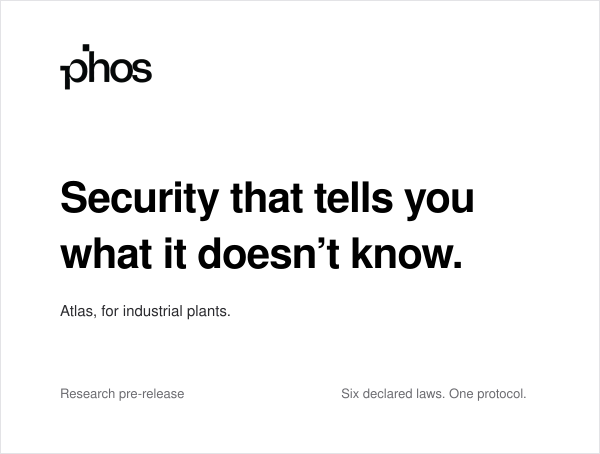
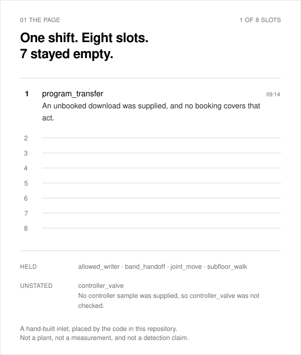
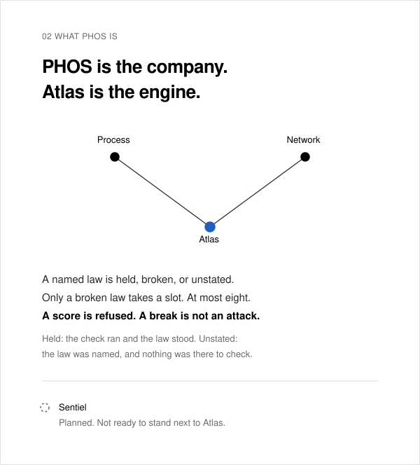
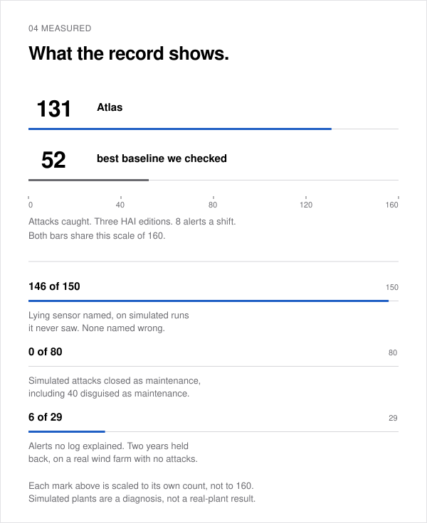
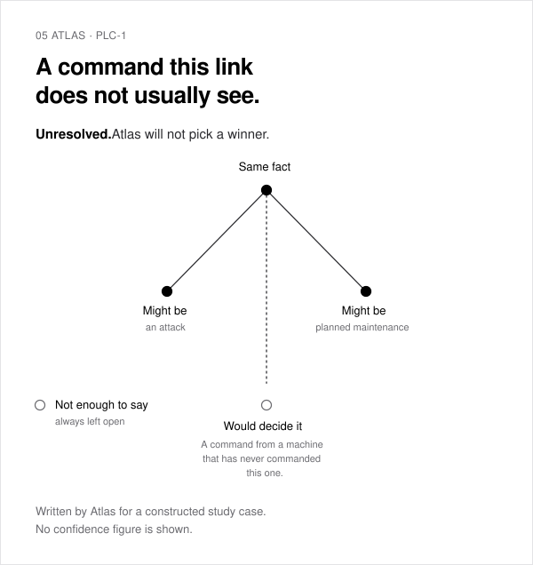
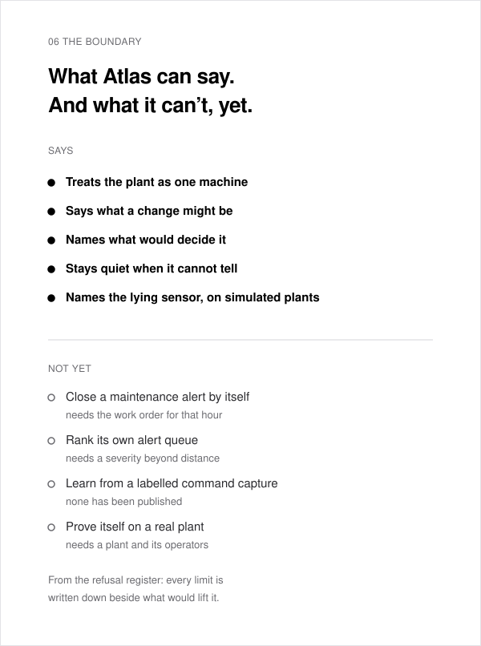

<picture>
  <source media="(prefers-color-scheme: dark)" srcset=".github/assets/readme/poster-dark.svg">
  
</picture>

A plant names the laws in force. Each named law is held, broken, or unstated. Only a broken law takes a slot. The page holds at most eight, ordered by time, then by the law's name. Every sentence names its law, then the fact. A score is refused. A break is a false law. The page does not name the cause. Held means the check ran and the law stood. Unstated means the plant named the law and supplied nothing that law can be checked against. An empty register checks nothing.

<picture>
  <source media="(prefers-color-scheme: dark)" srcset=".github/assets/readme/page-dark.svg">
  
</picture>

That page is not a drawing of the product. It is the product: a hand-built inlet, placed by the code in this repository and rendered when this file was built. Seven slots stayed empty because nothing broke in them.

<picture>
  <source media="(prefers-color-scheme: dark)" srcset=".github/assets/readme/company-dark.svg">
  
</picture>

Someone with a valid login sets off no alarm by the login itself. What they change is how the plant runs.

<picture>
  <source media="(prefers-color-scheme: dark)" srcset=".github/assets/readme/laws-dark.svg">
  
</picture>

The code of that page is `src/phos/atlas/declared_law.py`. A law this page has no check for is listed and takes no line. An empty list of laws checks nothing.

There is no screen, no service, and no connection to a control network. The next step is one plant that exports its files and writes the laws. If no plant agrees, the product sequence stops. The page stays. A price for the company has no date here.

The three plates below are measurements of the older detectors. They are kept so a published number can still be rebuilt. They are not the page, and the page does not carry a score.

<picture>
  <source media="(prefers-color-scheme: dark)" srcset=".github/assets/readme/measured-dark.svg">
  
</picture>

<picture>
  <source media="(prefers-color-scheme: dark)" srcset=".github/assets/readme/alert-dark.svg">
  
</picture>

<picture>
  <source media="(prefers-color-scheme: dark)" srcset=".github/assets/readme/boundary-dark.svg">
  
</picture>

[Release note](docs/release.md). [The record](docs/). Everything PHOS has measured, including what didn't work. [Eight alerts](docs/whitepaper/hn_technical_post.md). [What the page refuses](docs/whitepaper/eight-alert-non-admission.md). [A function code is not a download](docs/whitepaper/modbus-is-not-a-program-transfer.md). [Membership is declared, not inferred](docs/whitepaper/topology-is-declared-not-inferred.md). [The detectors that were refused](docs/whitepaper/lanes-that-were-refused.md). [A score is not a rank](docs/whitepaper/a-score-is-not-a-rank.md). [A broken law, or silence](docs/#a-broken-law-or-silence).

### A plant

PHOS is looking for one site that can export historian files and write down which laws to check. The page will not show a score. PHOS will not connect to the control network. If you operate or secure an industrial site and can do that, write to [elijahagumba.research@proton.me](mailto:elijahagumba.research@proton.me).

### Run it

```bash
uv sync
uv run phos demo
```

About fifteen seconds. The demo runs the older detectors on a simulated water plant for 120
hours. It is not the operator page. Then the demo shows what actually happened, and says so
plainly when it missed or raised a false alarm. Try `--scenario operator` and
`--scenario attacker` too.

```bash
uv run pytest -q
```

The test suite needs no datasets. Public corpora are downloaded separately and never committed; see
[data/README.md](data/README.md).

Research pre-release. Not deployable, and never run on a live plant.

Atlas is the industrial engine, and the work right now. Sentiel, for enterprise networks, is planned and not ready to stand next to it.

Built by one researcher with AI coding agents. Every published number reproduces from this repository and the public datasets it names.

Source-available under the [PolyForm Noncommercial License 1.0.0](LICENSE). Commercial use requires a licence.

PHOS
