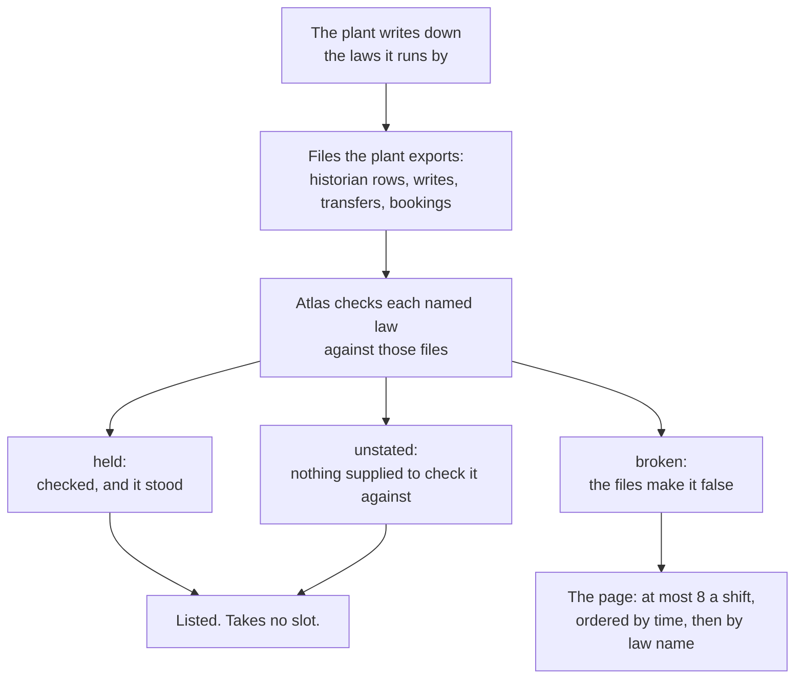
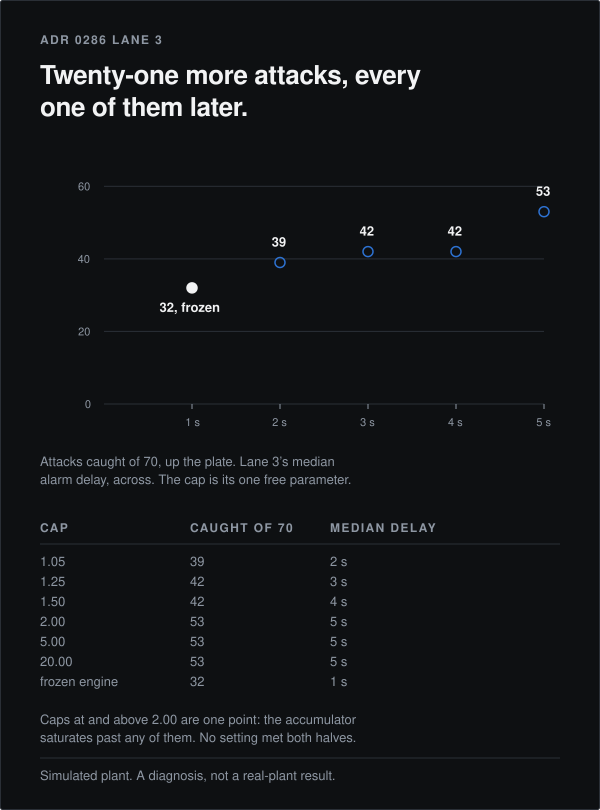
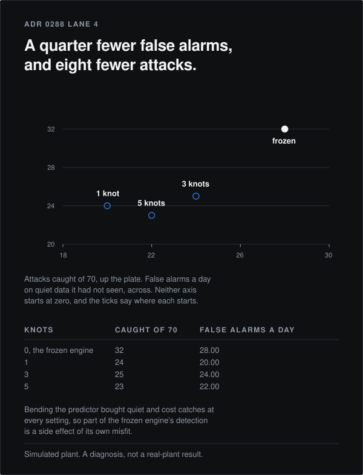
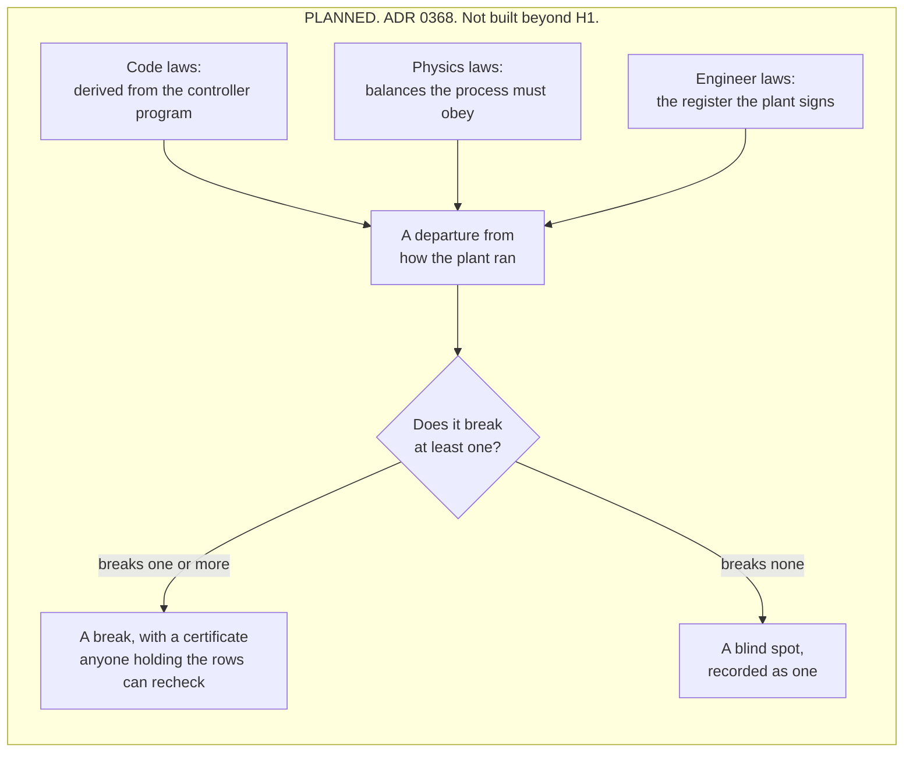
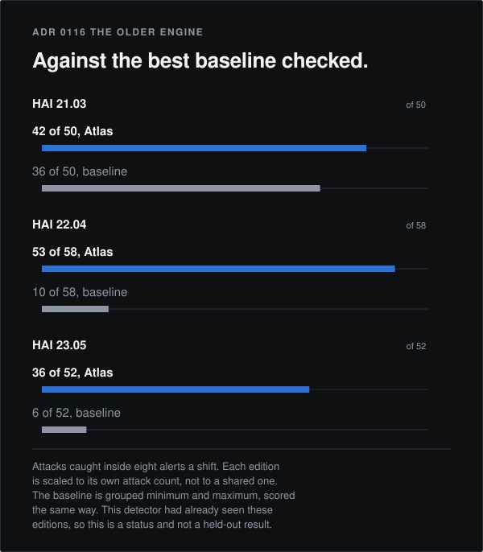

[](https://github.com/elijahagumba/phos/actions/workflows/research-core.yml)
&nbsp;**4,706 tests**, no datasets required.

**PHOS is an independent research project, built by one researcher with AI coding agents.** There is no company, no product and no customer. What there is, is a measurement record: every figure on this page reproduces from this repository and the public datasets it names, including the measurements that failed.

**The work is Atlas, and Atlas is a page.** The plant writes down the laws it runs by. Atlas checks whether each one still holds, and reports the ones that do not, **at most eight a shift**. It attaches no score, ranks nothing, and names no cause. Where the plant's own record cannot settle what happened, Atlas says so and stops. That refusal is the product and not a gap in it.

**Atlas is a witness, not a judge.** It says what it saw, names the law that makes it matter, and stops. A line on the page is not a verdict. It means someone should go and look.

### How a line reaches the page



Read as text: the plant's own rules go in, Atlas sorts every one of them into held, broken or unstated, and only a broken law reaches the page a person reads.

It is not a SCADA system, not personnel tracking, and not revision tracking. It does not connect to a control network.

## The problem

An industrial plant runs on the judgement of the people in its control room. A security system that guesses spends that judgement. Spend it twice and the third page goes unread.

The industry's answer has been to score everything and sort by the score. That produces a queue nobody finishes and a number nobody can explain. PHOS takes the opposite position: a system that cannot support a claim should be allowed to say so, and the page an operator reads should hold only what it can defend.

## The six laws

| Law | A break is |
| --- | --- |
| `joint_move` | Two tags written inside the ordinary band, close together in time |
| `subfloor_walk` | One tag stepped across that band for a fixed length |
| `band_handoff` | The same ordinary value on a second tag later, and no booking names both tags |
| `program_transfer` | A download, an upload, or an online edit, and nothing booked covers that act |
| `allowed_writer` | A write from a station the plant did not name |
| `controller_valve` | A valve that is not the value the plant's own comparison writes |

A law the plant names but this page cannot check is listed and takes no line. An empty page is not a claim that the plant is safe: it means the checks ran and the laws stood, or the plant named a law and supplied nothing to check it against. The code is [`src/phos/atlas/declared_law.py`](src/phos/atlas/declared_law.py).

## The contract, exactly

Four lines, and they are the whole of it. Each one is what `src/phos/atlas/declared_law.py` already enforces, not a description of what it is meant to do.

$$\mathcal{R} \;=\; H \;\sqcup\; B \;\sqcup\; U$$

Every law in the register the plant signed ends in exactly one of three standings: held, broken, or unstated. A law that turns up in two of them is refused, and no report is built.

$$\mathrm{page} \;=\; (\mathrm{sort}_{(t,\,n)} B)_{1 \ldots \min(|B|,\,8)}$$

The page is the broken laws, ordered by the time of the broken fact and then by the law's name, cut at eight. Held and unstated laws are listed and take no slot, and a later break is never promoted for being louder, because a break carries nothing to be louder with.

$$W \;=\; \{\textsf{confidence},\; \textsf{probability},\; \textsf{weight},\; \textsf{magnitude},\; \textsf{score}\}$$

Five words a sentence may not contain. The refusal is the word, not a number: a decimal the plant already uses is allowed, and a law whose own name carries one of these words is the plant's word and is read as a name.

$$\text{placed}(b) \iff \mathrm{type}(b) = \texttt{LawBreak} \;\wedge\; s_b = n_b \,\Vert\, \text{". "} \,\Vert\, f_b \;\wedge\; \forall w \in W: w \not\subseteq \mathrm{fold}(f_b)$$

A line is placed only if it is exactly a break, its sentence opens with its own law's name, and the fact after that name contains none of the five words in any case. The type check is exact rather than by inheritance, because a subclass could carry a magnitude. A sentence that fails any of the three raises, and nothing else in that call is placed either.

## What makes this different

Three commitments, each of which costs something.

**It is allowed to say nothing.** Held and unstated are real answers, and both are printed where the operator can see them. Most products cannot ship that, because a quiet page looks like a broken one.

**Every line names the law it came from.** The sentence is the law's name, then the checkable fact, and nothing else. There is no score to explain, no rank to defend and no cause asserted. What the page cannot settle, it declines to settle.

**The failures are published.** This repository contains the measurements that did not work and the detectors that were built and then refused. Three of them, all in the record:

A detector caught **more** attacks, 53 of 70 against the frozen engine's 32, and lost nothing. It arrived later, median 1 s to 5 s. The bar forbade a later alarm, so it was refused. [ADR 0286](docs/adr/0286-an-appended-column-cannot-win-a-slot-without-taking-the-alert.md)



A better-fitting predictor cut false alarms on unseen quiet data from 28.00 a day to 20.00–24.00, and cut attacks caught from 32 to 23–25, at every setting. Part of the frozen engine's detection turns out to be a side effect of its own misfit. [ADR 0288](docs/adr/0288-the-linear-predictors-misfit-is-load-bearing.md)



The operator queue was ranked by residual magnitude. The loudest alerts pointed **away** from the attacks, so the magnitude was taken off the page entirely. [ADR 0068](docs/adr/0068-the-atlas-operator-queue-cannot-be-ranked.md)

That third one has no chart here, and the reason is worth stating. The record holds where the six true alerts sat in the queue, 187th, 204th, 255th, 320th, 348th and 359th of 424, and the magnitude at seven budget cuts. It does not hold a loudness paired with an attack flag for every one of the 424 alerts, and the corpus that would rebuild them is one this project does not reopen. So the figure is not drawn rather than drawn from something else.

A project that publishes the detectors it refused is making a different kind of promise from one that publishes only its wins.

## What it will not guess

A download, an upload and an online edit are three different acts, and Atlas keeps them apart. It will not decide from a byte on the wire that one of them happened; that has to come from the plant's own record. It cannot tell whether the act was booked, because the booking lives in scheduled downtime, a commissioning window or a check-in sheet, and Atlas has none of those yet.

So it will not call a contractor doing a requested change an intruder, and it will not call an intruder a contractor. Someone with a valid login sets off no alarm by the login itself. What they change is how the plant runs.

## What Atlas cannot do

Stated plainly, because a reader will find these out anyway:

- **It cannot rank its own alert queue.** On HAI the loudest alerts point away from the attacks.
- **It cannot separate maintenance from an attack without that hour's work order.** The same fact supports both explanations, and no public corpus ships a maintenance export.
- **It has never run on a live plant.** Every figure here comes from published corpora or simulation.
- **It has not been reproduced by anyone outside the project.**

## Three witnesses, and what they would miss

The six laws above are written by hand, by people. The next question is whether a plant's own controller program and its own physics can write laws too, and what a departure that breaks none of the three looks like.



Read as text: three independent sources of law, one departure, and two honest outcomes. A departure that breaks none of the three is written down as a blind spot rather than quietly missed.

This is named, not built. The first rung derives a law from an open-source simulator's controller program and checks it against the hand-written one, literal for literal. Nothing beyond that rung exists, and nothing here says Atlas would have caught any named real-world attack. [ADR 0368](docs/adr/0368-triangulation-and-a-self-search-are-named-after-brief-g.md)

## The older engine

Before the law page, PHOS built residual detectors: they learn what normal looks like for a plant, report what no longer fits, hold competing explanations open rather than collapsing them into one answer, and keep a confidence that is not shown at all until it is calibrated against held-out data. Those detectors are still in the repository, so every published figure can be rerun. **They are not the page, and the page carries none of their numbers.**


### What the older engine measured

**On real testbed data.** On HAI 21.03, 22.04 and 23.05, inside eight alerts an operator can read in a shift, Atlas caught **42 of 50**, **53 of 58** and **36 of 52**: together **131 of 160**. The best baseline checked, scored the same way, caught 36, 10 and 6: together **52**. These editions had already been seen by this detector, so that figure is a status rather than a held-out result, and it is reported as one. [ADR 0116](docs/adr/0116-a2-status-four-of-five-beyond-chance.md)



**On a real wind farm**, two years held back and scored once, with no attacks in it: 6 of 29 alerts were not explained by the turbines' own logs. [ADR 0178](docs/adr/0178-kelmarsh-held-back-years-were-scored-once.md)

**On simulated plants**, which are a diagnosis and not a result about a real plant: giving the engine the control traffic took attacks caught from **49 of 120 to 87 of 120** on twenty runs it had never seen, and reconnaissance from **0 to 20 of 20**, with benign alerts unchanged at 6 of 40. The gain is attribution, and an attacker working from the operator's own console defeats it. The lying sensor was named in **146 of 150** runs, none named wrong. **0 of 80** simulated attacks were closed as maintenance, including 40 dressed up as maintenance. [ADR 0276](docs/adr/0276-lane-1-met-its-bar-on-held-out-runs.md)

**Against its own criteria.** Version 1 meets **8 of 12** criteria written down before any of these comparisons were run. The four unmet are the alert queue's ranking, a reproduction an outsider can run, Sentiel finding more people, and the onboarding trial.


## Sentiel, the second engine

The thesis behind two engines is that **"normal" is not one thing.** A water treatment plant and a corporate network are different kinds of environment, with different physics, different rhythms and different reasons for a thing to be unusual. One model stretched across both is worse at each. So PHOS builds two: **Atlas** for industrial plants, **Sentiel** for enterprise networks. A third part, **PHOS Intelligence**, is planned to correlate what the two engines independently conclude. Atlas is the work right now, which is why most of this page is Atlas.

Sentiel is for enterprise networks, where "normal" is a person's working pattern rather than a pump's physics. Its job is the same speech contract in a different world: for a person on a day, hold competing explanations open, `compromised_account`, `insider_misuse`, `peer_anomaly`, `legitimate_change`, `insufficient_evidence`, and report the evidence for each rather than a single verdict with a number on it.

**Where it honestly stands: not ready to stand next to Atlas.** On the public insider-threat corpus it finds one of two insiders, and the bet to find the other ran once and lost. A peer-group advantage that looked real was measured, failed to survive, and was retired rather than quietly kept. Sentiel finding more people is one of the four v1 criteria that version 1 does not meet.

It is on this page because PHOS is two engines and one ontology, not because it is finished.


## Where this goes

The next step is **one plant**: a site that exports its own historian files and writes down, in its own words, the laws it runs by. Everything on this page was measured on published corpora and simulation, and no amount of either substitutes for one real plant's notion of normal.

If a plant agrees, the second year builds on its data. If no plant agrees, the product sequence stops, and the page and the record stay as they are. That is written down rather than left implied.

## The record

Everything PHOS has measured, including what did not work.

[Release note](docs/release.md) · [The full record](docs/) · [The refusal register](docs/refusal-register.md) · [Every decision record](docs/adr/), grouped by theme and written before the score it reports · [The same work in plain English](<easy to reads/README.md>)

[Eight alerts](docs/whitepaper/hn_technical_post.md) · [What the page refuses](docs/whitepaper/eight-alert-non-admission.md) · [A function code is not a download](docs/whitepaper/modbus-is-not-a-program-transfer.md) · [Membership is declared, not inferred](docs/whitepaper/topology-is-declared-not-inferred.md) · [The detectors that were refused](docs/whitepaper/lanes-that-were-refused.md) · [A score is not a rank](docs/whitepaper/a-score-is-not-a-rank.md)

## Talk to us

**If you operate or secure an industrial site** and can export historian files and write down which laws matter: that is the conversation PHOS most wants to have. The page will not show a score, and PHOS will not connect to your control network.

The smallest version of that conversation needs no data and no permission: run `phos onboard` on your own export as described under [Run it](#run-it-on-your-own-plant), spend fifteen minutes correcting the tag list it gives you, and send back the corrections rather than the file. That list is where a declared map starts.

**If you are a researcher**, the measurements reproduce and the corpora are named. Disagreements about method are welcome in [Discussions](../../discussions).

Write to [elijahagumba.research@proton.me](mailto:elijahagumba.research@proton.me).

## Run it

Python 3.12 and [uv](https://docs.astral.sh/uv/).

```bash
uv sync
uv run phos demo
```

About fifteen seconds. The demo runs the older detectors on a simulated water plant for 120 hours. It is not the operator page. The demo then says what actually happened, including when it missed or raised a false alarm. `--scenario operator` and `--scenario attacker` are the other two incidents.

### Run it on your own plant

If you have a historian export, point this at it:

```bash
uv run phos onboard --historian your-export.csv
```

It proposes a role and a kind for every tag — which columns are readings, which are commanded, which are targets somebody set — and prints the token or the statistic each proposal came from. Where it has nothing to go on it leaves the cell blank rather than guessing.

**Nothing leaves your machine.** It reads the one local file you name, makes no network calls, starts no agents and no subprocesses, and writes nothing except the brief you asked for. A network capture is optional: `--capture` adds the tags a capture observed, and the brief works without one.

A suggestion is not a declaration ([ADR 0123](docs/adr/0123-the-plant-map-proposed.md)): a role Atlas trusts is read from a plant's documentation, never from a tag name and never from the data. The output is a draft for an engineer to correct, and **the corrected list is the thing worth sending back** — not the data. If you run it, we would like to know where it was wrong, and nothing else.

```bash
uv run pytest -q
```

4,706 tests, about three minutes, and no datasets required: the suite runs on a fresh clone with nothing downloaded. Public corpora are fetched separately and never committed; see [data/README.md](data/README.md).

---

Research pre-release. Not deployable, and never run on a live plant.

Built by one researcher with AI coding agents. Every published number reproduces from this repository and the public datasets it names.

Source-available under the [PolyForm Noncommercial License 1.0.0](LICENSE). Commercial use requires a licence.

PHOS
