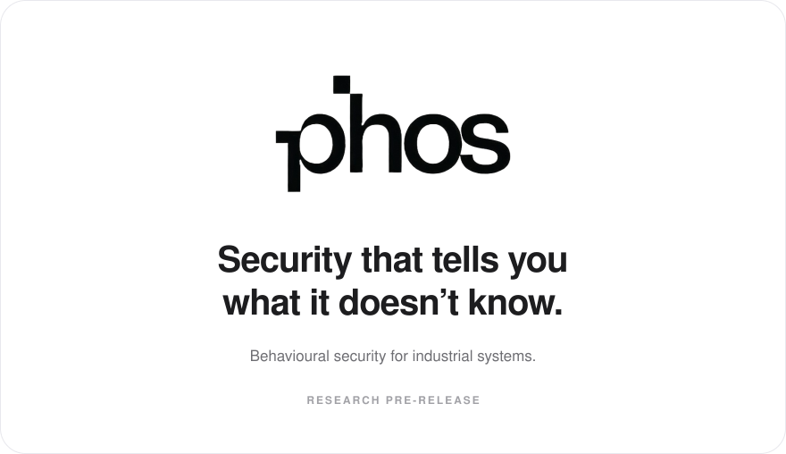
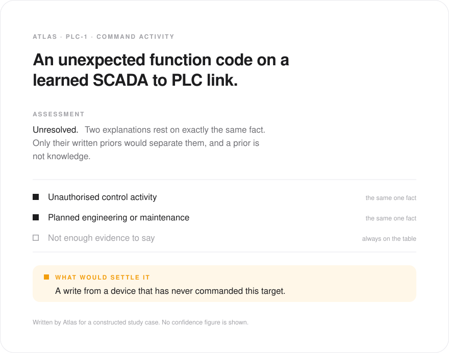
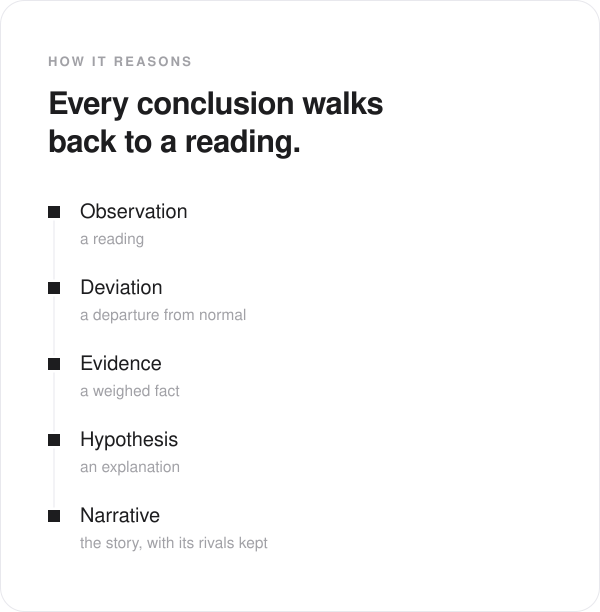
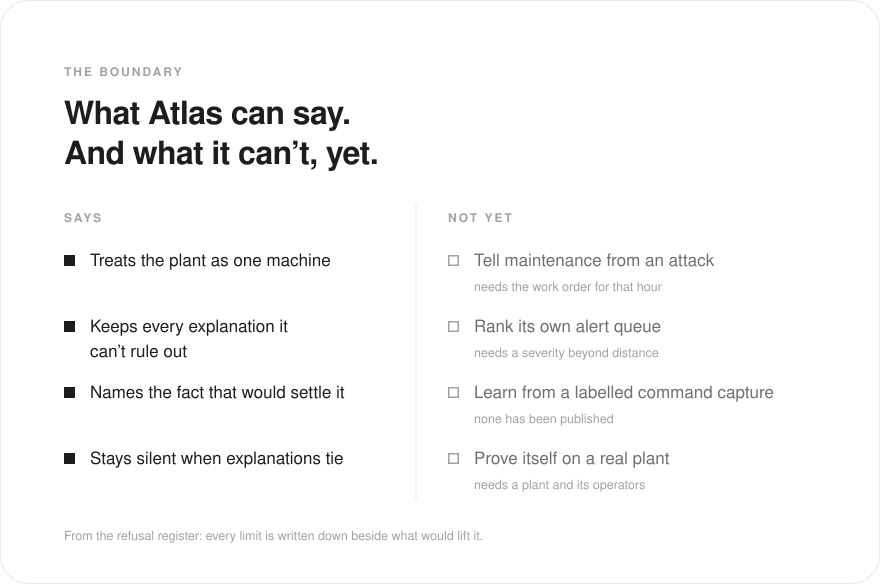

<p align="center">
  
</p>

<br>

<p align="center">
  An attacker with valid credentials breaks no signature.<br>
  What they change is how the plant behaves.
</p>

<p align="center">
  PHOS learns how a plant behaves when nothing is wrong. When that changes,<br>
  it writes down every explanation it can't rule out, and the one fact that would settle it.
</p>

<br>

<p align="center">
  
</p>

<br>

<p align="center">
  
</p>

<br>

<p align="center">
  
</p>

<br>

<p align="center">
  <a href="docs/atlas-report.md">Atlas report</a>
  &nbsp;&nbsp;·&nbsp;&nbsp;
  <a href="docs/refusal-register.md">Refusal register</a>
  &nbsp;&nbsp;·&nbsp;&nbsp;
  <a href="docs/synthetic-harness-method.md">Simulated plants</a>
  &nbsp;&nbsp;·&nbsp;&nbsp;
  <a href="docs/adr/">Design decisions</a>
</p>

<br>

### Run it

```bash
uv sync
uv run pytest -q
```

The suite needs no datasets. Public corpora are downloaded separately and never committed; see
[data/README.md](data/README.md).

<br>

<p align="center">
  <sub>Research pre-release. Not deployable, and never run on a live plant.</sub><br>
  <sub>Atlas models industrial plants. Sentiel, its enterprise sibling, is research only.</sub><br>
  <sub>Built by one researcher with AI coding agents. Every published number reproduces from this repository and the public datasets it names.</sub><br>
  <sub>Source-available under the <a href="LICENSE">PolyForm Noncommercial License 1.0.0</a>. Commercial use requires a licence.</sub>
</p>
