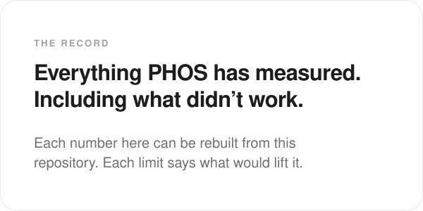

  

 

### Start here

1. **What Atlas does on real data:** the section below, each result linked to its record.
2. **What it will not claim:** the [refusal register](refusal-register.md).
3. **How each number was earned:** every result has a decision record in [adr/](adr/), written
   before the score it reports.

 

### What Atlas measured

**On real testbed data.** HAI is a public dataset recorded from a hardware-in-the-loop industrial
testbed. On its three editions not used to build the detector, at the budget of 8 alerts an
operator can read in a shift, Atlas caught **42 of 50**, **53 of 58** and **36 of 52** attacks. The
best baseline checked, scored the same way, caught 36, 10 and 6. On all three, Atlas was above
every one of 500 random draws of the same budget.
[ADR 0116](adr/0116-a2-status-four-of-five-beyond-chance.md)

**A better idea that failed the real test.** A learned map of the plant, which caught far more
falsified sensors on simulated plants, was taken once to those same editions. It caught fewer
attacks than the current detector on two of them and more on none, so it was not adopted.
[ADR 0143](adr/0143-the-plant-map-fails-the-gate.md)

**Naming the lying sensor, on simulated plants.** Explaining the current detector's alerts, the
plant map named the falsified instrument on **146 of 150** runs it had never seen, none wrong, and
reconstructed the true value within 5% of the instrument's range.
[ADR 0170](adr/0170-every-control-coupling-is-a-loop-and-bars-only-its-outputs.md)

**A real plant with no attacks.** On six wind turbines at Kelmarsh over 2019 to 2022, the
unchanged detector raised 74 alerts in about 26,000 shifts; the turbines' own status logs explained
57 of them. On 2023 and 2024, held back and scored once, it raised 29 and the logs explained 23.
[ADR 0165](adr/0165-kelmarsh-round-2-trains-on-2018.md),
[ADR 0178](adr/0178-kelmarsh-held-back-years-were-scored-once.md)

**What does not work yet.** On harder simulated cases, such as a fault during maintenance or two
sensors failing together, the leading explanation was right 33 times in 54, and right and wrong
answers carried the same confidence, so no confidence figure is shown
([ADR 0176](adr/0176-w5-held-back-confidence-is-declared.md)). On real network captures from the
4SICS lab, most traffic was Siemens S7, which Atlas does not decode yet
([ADR 0177](adr/0177-4sics-development-days-are-declared.md)).

[How the current detector entered the engine →](adr/0107-the-consistency-detector-enters-the-engine.md)

Earlier measurements, before the current detector

An earlier Atlas, treating the plant as one connected machine rather than watching each sensor
alone, cut false alarms on a slice of HAI from 8,390 to 647 an hour without missing an attack, and
grouping alarms by physical unit cut what an operator would read by a further 12 times. That still
left about 53 false alarms an hour, and the slice held only two attack windows. A calibration fitted
only on ordinary operation read 3.55 an hour; it is
[recorded beside the original number](adr/0083-calibrator-without-labelled-positives.md). The
current detector replaced that approach and is measured by attacks caught within the alert budget.

[Read the August 2026 Atlas report, kept as written →](atlas-report.md)

 

### What PHOS refuses to claim

Twenty-six things PHOS will not say, each with the evidence that rules it out and what would change
that. Atlas cannot tell maintenance from an attack without the work order for that hour. It cannot
rank its own alert queue: the loudest 96 alerts on HAI contained none of the real attacks.

[Read the refusal register →](refusal-register.md)

 

### How the simulated plants avoid fooling us

Three simulated plants (water treatment, power generation and a batch reactor) record their true
internal state separately from what their sensors report, so a miss is judged against what actually
happened. The attacks were written by people who could read the detector. Five rules stop the
simulator from quietly favouring Atlas, and each was tested by breaking it on purpose to make sure
the build fails. Of the three plants, one currently supports a detection claim.

[Read the method →](synthetic-harness-method.md)

 

### What Sentiel found, and the first open bet

Sentiel, the engine that watches people, finds one of the two labelled insiders in CERT r3.1, a
public insider-threat dataset, and cannot see the other. The reason is arithmetic: at least 14 of
its 34 signals must move at once before anyone can be flagged. The fix, its success test and our
own prediction that it won't be enough were all written down before any code. The bet was run once
on 18 October 2026 and lost: no declared formula put the second insider in the top 48.
[ADR 0148](adr/0148-bet-001-is-scored-once.md)

A later investigation found a signal that puts both insiders in the alerts on that dataset: a
return to a web host nobody else uses. We treat it with caution. In this dataset no innocent person ever
returns to such a host, which may be how the dataset was generated rather than how people
behave, and the result was counted before it was declared. It will be tested once on a larger
release it has not seen, with a declared check for exactly that question.
[ADR 0195](adr/0195-a-return-to-a-host-nobody-else-has-used.md),
[ADR 0196](adr/0196-exclusive-host-return-is-the-r42-one-shot.md)

[Read Bet 001: the second insider →](bets/001-the-second-insider.md)

The bar Atlas and Sentiel v1 must clear was fixed before any comparison was run.

[Read Bet 002: what v1 has to do →](bets/002-atlas-and-sentiel-v1.md)

 

### Why it is built this way

More than 170 design decisions, each with what was chosen, what was rejected and what it cost.
Several exist only to record a result that did not work. Five places to start:

- [The joint model, and the model that lost](adr/0009-joint-modelling-per-signal-attribution-and-the-model-that-lost.md)
- [A tie is a refusal, not an alphabetical winner](adr/0036-a-lead-tie-is-a-refusal-not-an-alphabetical-winner.md)
- [There is no labelled public command capture](adr/0040-no-labelled-public-command-corpus.md)
- [The operator queue cannot be ranked](adr/0068-the-atlas-operator-queue-cannot-be-ranked.md)
- [The false alarms were the model's, not the plant's](adr/0075-the-hai-false-alert-load-is-modelling-error-not-missing-evidence.md)

[Browse every decision →](adr/)

 

  The documents behind these pages are the working record, written as the research happened. They are dense by design.

